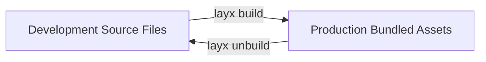

# LayX Build & Bundling Engine

The LayX build engine is engineered specifically for modern, high-performance landing pages. It provides automated production optimization without the overhead or configuration complexity of generic full-stack bundlers.

---

## ⚡ Key Highlights

1. **Non-Destructive CSS Minification**:
   - Preserves cutting-edge CSS features (`@layer`, `@starting-style`, dynamic viewport units `dvh/svh`, color-mix, relative colors).
   - Removes unused responsive 12-column grid layout classes by scanning your HTML.
2. **ESBuild JavaScript Bundling**:
   - Bundles all modules imported by `layx/layx.js` and `assets/js/base.js` into optimized production chunks with tree-shaking.
3. **HTML Transformation**:
   - Automatically comments out multiple development `<link>` and `<script>` tags in `index.html` and `pages/*.html`.
   - Injects single production bundles (`/assets/css/base.css` and `/assets/js/base.js`).
4. **Sharp Image Optimization**:
   - Automatically converts PNG and JPEG assets in `assets/image/` to AVIF (and WebP) using high-speed native bindings.
   - Losslessly minifies SVG vector files.
5. **Two-Way Lifecycle (`build` & `unbuild`)**:
   - Build for deployment, then restore back to development source files at any time.

---

## 🔄 Two-Way Lifecycle



### 1. `layx build`
Run this before deploying to production:
```bash
layx build
# or
npm run build
```

**What happens during `layx build`:**
1. **CSS Bundling**:
   - Reads `layx/layx.css` and resolves all `@import` rules.
   - Extracts HTML classes used across `index.html` and `pages/*.html` to strip unused grid column classes.
   - Combines framework CSS and `assets/css/base.css` into a minified bundle at `assets/css/base.css`.
   - Moves original base CSS to `layx/assets/css/user_base.css` for safe restoration.
2. **JavaScript Bundling**:
   - Runs `esbuild` on `assets/js/base.js` and `layx/layx.js`.
   - Bundles, tree-shakes, and minifies the code into `assets/js/base.js`.
3. **HTML Rewiring**:
   - In `index.html` and `pages/*.html`, wraps development `<link href="/layx/layx.css">` and `<script src="/layx/layx.js">` in special HTML comments:
     ```html
     <!--layx:style-->
     <!--<link rel="stylesheet" href="/layx/layx.css">-->
     <!--/layx:style-->
     ```
4. **Image & SVG Optimization**:
   - Converts raster images to modern `.avif` / `.webp` formats.
   - Optimizes `.svg` files while backing up originals to `layx/assets/image/`.

---

### 2. `layx unbuild`
Need to make edits or continue local development after running a build?
```bash
layx unbuild
# or
npm run unbuild
```

**What happens during `layx unbuild`:**
1. Restores all HTML tags from `<!--layx:style-->` and `<!--layx:script-->` comments.
2. Restores original development `assets/css/base.css` and `assets/js/base.js` from `layx/assets/`.
3. Restores original uncompressed SVGs and image backups.
4. Leaves your project completely clean and ready for development.

---

## ⚙️ Configuration (`config.mjs`)

Every LayX project has a `config.mjs` file in the project root allowing you to configure the bundler:

```javascript
// configuration for JavaScript and build processing
export const config = {
  build: {
    layx: {
      minify: true,
      sourcemap: false,
      format: 'esm',
      target: 'esnext',
      charset: 'utf8',
    }
  }
};
```
